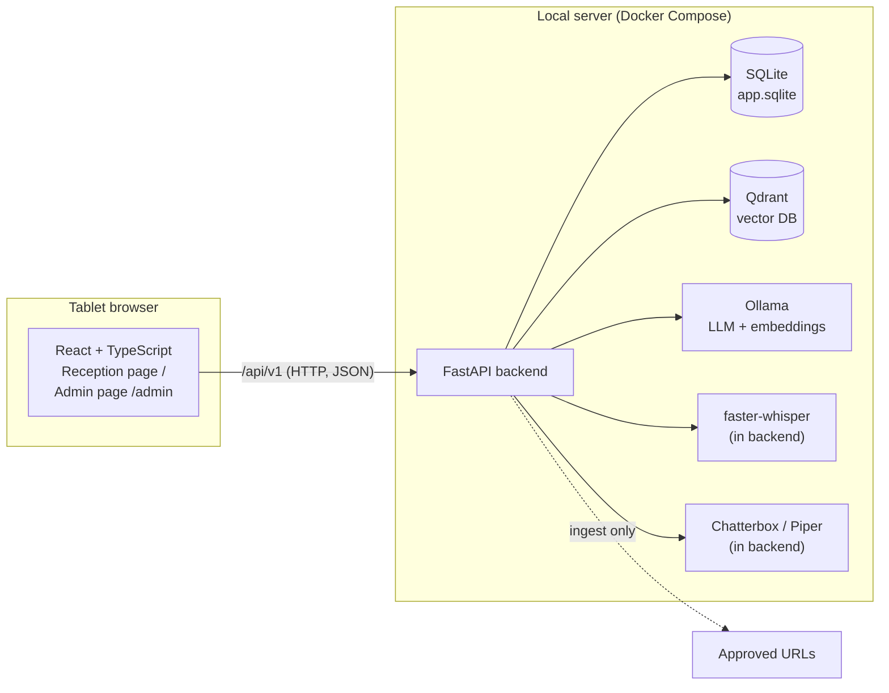
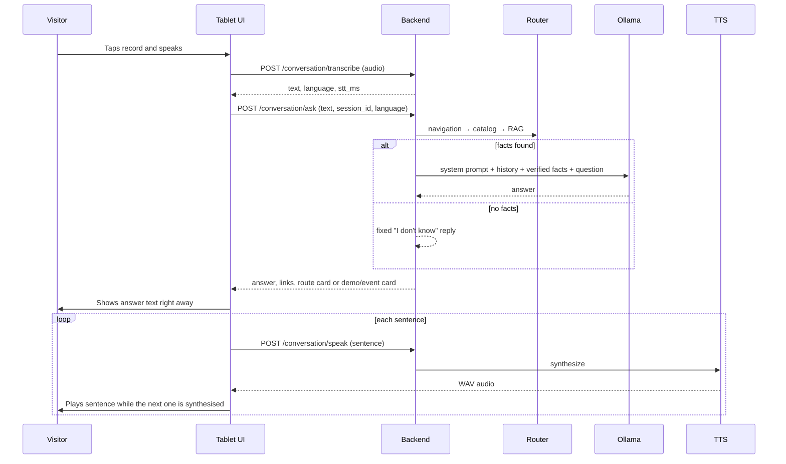
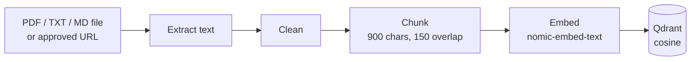

# AI Receptionist Robot (Lena) – Project Documentation

|                  |                                                   |
| ---------------- | ------------------------------------------------- |
| Course           | Mediapalveluprojekti                              |
| Group            | MAP25-R2                                          |
| Version          | 1.0                                               |
| Date             | 21.11.2026                                        |
| Previous version | 0.1 (07.09.2026, requirements specification only) |

This document describes what the project set out to do, what has been implemented, how it was built and how it works. It does not go through the code line by line. Installation and running instructions are in [README.md](README.md). Model benchmarks are in [backend/eval/](backend/eval/).

## Contents

1. [Background and goal](#1-background-and-goal)
2. [Implementation status](#2-implementation-status)
3. [Architecture](#3-architecture)
4. [How a conversation works](#4-how-a-conversation-works)
5. [Knowledge base (RAG)](#5-knowledge-base-rag)
6. [Reception tablet UI](#6-reception-tablet-ui)
7. [Admin panel](#7-admin-panel)
8. [Data storage](#8-data-storage)
9. [Model choices and evaluations](#9-model-choices-and-evaluations)
10. [Configuration and deployment](#10-configuration-and-deployment)
11. [Testing and CI](#11-testing-and-ci)
12. [Known limitations and future work](#12-known-limitations-and-future-work)

---

## 1. Background and goal

Nokia Espoo Innovation Garage is a space for demonstrations, workshops and events. It has limited signage, information about Nokia, the Garage and the Veturi programs is spread across many sources, and a human receptionist is not always available.

The project built **Lena**, an AI receptionist that runs as a web app on a tablet. Lena:

- welcomes visitors and introduces herself and the venue;
- answers questions about Nokia, the Innovation Garage, the Veturi programs, demos and events, using only approved documents and URLs (RAG);
- gives indoor directions from structured location data;
- speaks and listens (local speech-to-text and text-to-speech), and also shows answers as text with QR codes for links;
- runs entirely on local infrastructure. STT, LLM, embeddings, vector search and TTS never call a cloud AI service.

**Users**

| User                                                     | Needs                                                                                                                                |
| -------------------------------------------------------- | ------------------------------------------------------------------------------------------------------------------------------------ |
| Visitor (guest, employee, workshop or event participant) | Understand the venue, learn about Nokia, demos and projects, find rooms and events                                                   |
| Content owner / staff                                    | Manage documents, URLs, demos, events, locations and Lena's welcome message without touching code; review conversations and feedback |

**Out of scope:** facial recognition or visitor identification, unrestricted internet access for the AI, building a physical robot.

## 2. Implementation status

Status of the requirements from the original specification (v0.1).
✅ implemented · 🟡 partly implemented · ❌ not implemented

### Functional requirements

| #        | Requirement                                                             | Status | Notes                                                                                                                  |
| -------- | ----------------------------------------------------------------------- | ------ | ---------------------------------------------------------------------------------------------------------------------- |
| FR-01    | Tablet-optimised UI                                                     | ✅     | React web app with a kiosk lock (section 6)                                                                            |
| FR-02    | Default persona "Lena"                                                  | ✅     | Persona is defined in the system prompt and in `knowledge/documents/lena-info.md`. Switching personas is not supported |
| FR-03–07 | Voice in → local STT → LLM with retrieved knowledge → local TTS out     | ✅     | faster-whisper → Qdrant → Ollama → Chatterbox or Piper                                                                 |
| FR-08    | Predefined welcome interaction                                          | ✅     | Welcome text can be edited in the admin panel. Its audio is prepared in advance                                        |
| FR-09–13 | Answers about Nokia, Garage, Veturi, general topics, demos and projects | ✅     | From approved sources and the demo/event catalog                                                                       |
| FR-14    | Indoor navigation from stored locations and landmarks                   | ✅     | SQLite location table, editable in the admin panel                                                                     |
| FR-15–16 | Knowledge sources: documents (PDF first) and approved URLs only         | ✅     | PDF, TXT and MD files, plus URLs                                                                                       |
| FR-17–19 | Backend fetches approved URLs; extract → clean → chunk → embed → index  | ✅     | Section 5                                                                                                              |
| FR-20    | QR codes for relevant links                                             | ✅     | QR codes are shown only for source URLs returned with the answer. Answers without a source link show no QR             |
| FR-21    | Content owner can add, view and remove sources                          | ✅     | They can also rename sources, view chunks and reindex                                                                  |
| FR-22    | English first; answer in the visitor's language when supported          | 🟡     | English and Finnish. Requests in other languages get an English answer with a note                                     |
| FR-23    | Say so when no information is found, never invent                       | ✅     | No facts → fixed "I don't know" reply without calling the LLM. The prompt also has a strict refusal rule               |

### Non-functional requirements

| #            | Requirement                                        | Status | Notes                                                                                                                                 |
| ------------ | -------------------------------------------------- | ------ | ------------------------------------------------------------------------------------------------------------------------------------- |
| NFR-01/02/04 | All AI processing and confidential data stay local | ✅     | Models run in local containers. Model weights are downloaded only on the first start                                                  |
| NFR-03       | Internet only for approved URLs                    | ✅     | Only the backend ingest code fetches URLs. The LLM has no browsing tool                                                               |
| NFR-05       | Low latency to first response                      | ✅     | The answer text appears before speech is ready, and speech plays one sentence at a time. STT, LLM and TTS times are logged per turn.  |
| NFR-06       | Simple, training-free use; voice first             | ✅     | Large record button, text input as a fallback.                                                                                        |
| NFR-07       | Graceful handling of failures                      | ✅     | Empty transcription, missing facts, failed ingest and unreachable URLs are reported or logged; a failing source does not stop startup |
| NFR-08       | Modular, replaceable LLM/STT/TTS                   | ✅     | Provider pattern selected by `.env` (section 3)                                                                                       |
| NFR-09       | Reproducible, documented deployment                | ✅     | Docker Compose with an optional GPU overlay; README                                                                                   |

## 3. Architecture



| Layer           | Technology                                                       | Role                                                                            |
| --------------- | ---------------------------------------------------------------- | ------------------------------------------------------------------------------- |
| Frontend        | React 19, TypeScript, Vite                                       | Reception and admin UI. `qrcode.react` for QR codes                             |
| Backend         | FastAPI (Python 3.11)                                            | Orchestrates the conversation, knowledge ingest and admin APIs                  |
| App database    | SQLite                                                           | Sources, conversation turns, feedback, demos, events, locations, kiosk settings |
| Vector database | Qdrant                                                           | Embeddings of document and web page chunks                                      |
| LLM             | Ollama (`OLLAMA_MODEL`, default `qwen3:4b-instruct-2507-q4_K_M`) | Generates the answer from retrieved facts                                       |
| Embeddings      | Ollama `nomic-embed-text`                                        | Vectors for chunks and questions                                                |
| Speech-to-text  | faster-whisper (`medium`)                                        | English and Finnish transcription                                               |
| Text-to-speech  | Chatterbox Multilingual or Piper                                 | Spoken answers (see section 9)                                                  |
| Deployment      | Docker Compose                                                   | `ollama`, `qdrant`, `backend`, `frontend` services                              |

### Replaceable providers

LLM, STT, TTS and RAG all follow the same pattern in `backend/app/services/<provider>/`:

- `base.py` – a `Protocol` interface that the conversation service calls;
- `mock.py` – a stub that needs no models (used in tests and for UI work);
- a real adapter (`ollama.py`, `whisper.py`, `piper.py`, `chatterbox.py`, `qdrant.py`).

`backend/app/core/dependencies.py` builds the provider chosen in `.env` (`LLM_PROVIDER`, `STT_PROVIDER`, `TTS_PROVIDER`, `RAG_PROVIDER`). Each provider is created once per process, so models load only once. Replacing a component means writing one adapter and changing one setting. The API layer stays the same.

### Startup

When the backend starts (`app/core/bootstrap.py`) it:

1. creates the SQLite tables and seeds example demos, events and locations the first time;
2. waits for Ollama and pulls the LLM if it is missing;
3. downloads and loads the selected TTS voices and the Whisper model;
4. synthesises Lena's welcome message and keeps the audio in memory;
5. creates the Qdrant collection, indexes `knowledge/documents/` and the seed URLs from `KNOWLEDGE_URLS`, and registers them in the admin source list.

A source that fails to ingest is logged and skipped. It does not stop the server.

## 4. How a conversation works



### 4.1 Speech-to-text

The browser records audio with `MediaRecorder` and uploads it to `/conversation/transcribe`. faster-whisper first detects the language and then transcribes with the language **fixed** to English or Finnish. Finnish is chosen only when its probability is at least 0.6 and at least 0.15 above English. Otherwise the clip is treated as English. Fixing the language prevents a common Whisper failure: a weak "Finnish" guess would turn English speech into a Finnish translation. Voice activity detection (VAD) removes silence. The device and precision are picked automatically: CUDA with `int8_float16` when a GPU is visible, otherwise CPU with `int8`.

If nothing is recognised, the UI tells the visitor and does not send an empty question.

### 4.2 Routing the question

`ConversationService` (`backend/app/services/conversation.py`) decides where the facts come from, in this order:

1. **Navigation** – if the question contains a location name or one of its aliases as a whole word (`"reception"` does not match inside `"receptionist"`), the location's floor, landmark and directions become the facts, and the UI gets a route card with an optional photo.
2. **Demo/event catalog** – if the question matches the title of a visible demo or event, that entry becomes the facts, and the UI gets a card. Matching counts shared title words and ignores stop words. A short or generic word alone ("ai", "demo", "workshop", "system") is not enough unless the whole title is in the question. For example, "energy demo" finds "Energy Management System".
3. **RAG** – otherwise the question is embedded and the top chunks are retrieved from Qdrant (section 5).

**Follow-up questions.** The last 6 turns of the session are passed to the LLM, but only to resolve references. They are not a source of facts. A referential question ("how do I get there?", "what about that?") is matched against the previous navigation or catalog hit. If RAG finds nothing, the search is retried with the previous question added.

### 4.3 Answer generation

- **No facts found** → the LLM is not called. Lena answers "I don't know. I don't have information about that." (or "En tiedä. Minulla ei ole siitä tietoa." in Finnish). This makes FR-23 deterministic.
- **Facts found** → Ollama `/api/chat` is called with temperature 0.2. The prompt is: system prompt + visitor language, previous conversation, a "Verified facts" list, and the current question.

The system prompt (`backend/app/services/llm/prompt.py`) tells Lena to:

- answer in 1–4 sentences, in the visitor's language;
- use only the relevant verified facts;
- not read raw URLs aloud;
- never give passwords, Wi-Fi details, access codes, times, dates or names that are not written word for word in the facts, and use the fixed "I don't know" reply instead. This rule was added after the LLM evaluation showed that all models invented such details in Finnish (section 9).

After generation, every "Innovation Garage" mention is rewritten to the official name "Nokia Espoo Innovation Garage". Finnish case endings are kept ("Garagessa").

Each turn is saved with the question, answer, retrieved chunks, the full prompts and the STT, LLM and TTS durations, so staff can see why Lena answered as she did.

### 4.4 Text-to-speech

The answer text is shown as soon as the backend returns it. The frontend then splits the answer into sentences and calls `/conversation/speak` once per sentence. While one sentence plays, the next one is being synthesised, so speech starts after the first sentence instead of after the whole answer. The progress bar advances sentence by sentence.

The welcome message is synthesised at startup and cached. When the UI asks for exactly that text, the cached audio is returned immediately.

Two TTS engines are available (`TTS_PROVIDER`):

- **Chatterbox Multilingual** – one voice for English, Finnish and about 20 other languages. By default it clones the female Piper "Lessac" voice from a generated reference clip. `CHATTERBOX_CFG_WEIGHT=0` keeps the English accent out of Finnish speech. Generation is serialised (one request at a time), and a trimming step cuts off hallucinated audio at the end of a clip. It needs a GPU to be fast.
- **Piper** – fast and lightweight, with separate voices for English (`en_US-lessac-medium`) and Finnish (`fi_FI-harri-medium`). Voices download on the first start.

## 5. Knowledge base (RAG)

### Pipeline



- **Extraction.** PDFs are read with `pypdf`. TXT and MD files are read as UTF-8. For URLs the backend downloads the page (max 2 MB, no JavaScript rendering) and keeps only the main article content. Navigation, scripts and other page chrome are removed. Wikipedia pages are fetched as plain text through the Wikipedia API, and reference sections ("References", "See also", "External links" …) are dropped.
- **Chunking.** Whitespace is normalised and the text is cut into 900-character windows that overlap by 150 characters.
- **Embedding and storage.** Each chunk is embedded locally with Ollama and stored in Qdrant together with its source id, title, URL, chunk index and a SHA-256 hash of the source text.
- **Change detection.** If a source's text hash has not changed, it is not re-embedded. Seed URLs are kept from the cache on restart unless `KNOWLEDGE_REFRESH=true`.
- **Retrieval.** The question is embedded, and the top 5 chunks with cosine similarity of at least 0.25 are returned. URLs of the retrieved sources become the answer's links and QR codes.

### Managing sources

Content owners manage sources in the admin panel (section 7):

- add a URL or upload a file (stored in `knowledge/documents/`);
- rename a source (the name shown to visitors);
- remove a source (deletes its vectors and, for files, the file);
- view a source's chunks;
- reindex everything in a background thread. The list marks sources that are missing from the index or whose file has changed on disk.

The initial approved sources are `knowledge/documents/` (Lena's own info and Innovation Garage info) and these URLs:

- Nokia – https://en.wikipedia.org/wiki/Nokia
- Nokia Veturi programs – https://www.nokia.com/innovation/veturi-programs/
- Nokia Innovation Garages – https://www.nokia.com/innovate-with-nokia/nokia-garages/
- Oulu Garage – https://www.nokia.com/innovate-with-nokia/nokia-garages/oulu-garage/

Indoor navigation and demos/events are **not** stored in the vector database. They live in structured SQLite tables, so directions and times come from verified data instead of the LLM's interpretation of free text.

## 6. Reception tablet UI

Route `/`. Built for a tablet in kiosk use.

- **Welcome.** Lena's welcome message is shown and spoken when the page opens.
- **Voice input.** A large record button records, uploads and transcribes. The recognised text is sent as a question. A text field is available as a fallback.
- **Answers.** Shown as chat bubbles with a "thinking" placeholder while waiting. Each answer can be replayed or stopped.
- **Cards.** Navigation answers show floor, landmark, directions and a photo. Demo and event answers show description, location or room and time, and a photo.
- **Links and QR codes.** Links are shown as chips. Tapping one opens a QR code that the visitor can scan with a phone. URLs in the text are also turned into chips.
- **Volume control.** Up to 200 %, through the Web Audio API. Remembered in the browser.
- **Idle handling.** After `VITE_CHAT_IDLE_SECONDS` (default 60 s) without a new question, Lena asks "Are you still there?". If nobody answers, a new conversation starts so the next visitor does not see the previous visitor's chat.
- **New chat** button for the same reset.
- **Survey mode.** Staff can switch the tablet from chat to a feedback form (1–5 rating and comment).
- **Kiosk lock.** Disables the context menu, text selection, dragging and external links, so visitors cannot leave the app through the browser.

UI states: `welcome`, `idle`, `listening`, `processing`, `speaking`, `error`.

## 7. Admin panel

Route `/admin`. Tabs:

| Tab               | What staff can do                                                                                                                                              |
| ----------------- | -------------------------------------------------------------------------------------------------------------------------------------------------------------- |
| Basic settings    | Switch the reception tablet between chat and survey mode; edit Lena's welcome message (the new audio is synthesised on save)                                   |
| Demos & events    | Add, edit, hide or delete demos (title, description, location, URL) and events (title, time, room, description); upload a photo (JPEG, PNG or WebP, max 48 MB) |
| Knowledge sources | Add a URL or file, rename, remove, view chunks, reindex; see stale or missing sources                                                                          |
| Map               | Add, edit, reorder and delete indoor locations: name, floor, landmark, directions, the phrases visitors might say (aliases), and a photo                       |
| Chat history      | Browse sessions; per turn see the question, answer, retrieved chunks, system and user prompts, and STT/LLM/TTS timings; delete sessions                        |
| Feedback          | View and delete visitor ratings and comments                                                                                                                   |

All admin actions use the same REST API (`/api/v1/...`). Interactive API documentation is at `/api/docs`.

## 8. Data storage

| Store     | Location                                                                            | Contents                                                                                                                                                                                                                        |
| --------- | ----------------------------------------------------------------------------------- | ------------------------------------------------------------------------------------------------------------------------------------------------------------------------------------------------------------------------------- |
| SQLite    | `knowledge/app.sqlite`                                                              | `sources` (source catalog and custom titles), `turns` (conversation log with prompts and timings), `feedback`, `demos`, `events`, `locations` (with aliases and photos), `kiosk_settings` (mode, welcome text), `seed_versions` |
| Qdrant    | Docker volume `qdrant_data`                                                         | Chunk vectors and payload, collection `lena_knowledge`                                                                                                                                                                          |
| Documents | `knowledge/documents/`                                                              | Uploaded and seed files                                                                                                                                                                                                         |
| Models    | Docker volumes `ollama_data`, `whisper_models` (Hugging Face cache), `piper_models` | Downloaded model weights                                                                                                                                                                                                        |

Missing columns are added to existing databases at startup, so older `app.sqlite` files keep working. Example demos, events and locations are seeded only once.

## 9. Model choices and evaluations

### Speech-to-text

Whisper tiny, base and small and Vosk small were compared on CPU ([backend/eval/stt/](backend/eval/stt/)).

| Model      | English WER | Finnish WER | Mean time (s) | Peak RAM (MB) |
| ---------- | ----------- | ----------- | ------------- | ------------- |
| tiny       | 10.0 %      | 53.3 %      | 0.8           | 229           |
| base       | 3.3 %       | 53.3 %      | 1.4           | 334           |
| small      | 0.0 %       | 40.0 %      | 4.6           | 698           |
| vosk-small | 6.7 %       | –           | 2.3           | 202           |

The small models handle English well but Finnish poorly. The project therefore uses Whisper **medium**, which is fast enough on a GPU with `int8_float16`, together with the fixed-language logic in section 4.1. The test set is small (4 clips per language), so these results show the trend only.

### LLM

Seven local Ollama models were tested with 12 reception questions (6 English, 6 Finnish), each run twice and graded by hand ([backend/eval/llm/](backend/eval/llm/)).

| Model                          | Quality                    | Median answer time | Memory |
| ------------------------------ | -------------------------- | ------------------ | ------ |
| llama3.2:1b (previous default) | 29 %                       | 0.9 s              | 1.7 GB |
| gemma3:1b                      | 73 %                       | 1.4 s              | 1.1 GB |
| qwen3:1.7b                     | 65 %                       | 1.1 s              | 1.8 GB |
| phi4-mini                      | 71 %                       | 1.9 s              | 3.4 GB |
| gemma3:4b                      | 75 % → 88 % with fixes     | 3.1 s              | 2.7 GB |
| **qwen3:4b-instruct-2507**     | 77 % → **85 % with fixes** | 2.3 s              | 3.3 GB |
| llama3.1:8b                    | 67 %                       | 5.6 s              | 5.2 GB |

"With fixes" means temperature 0.2 and the refusal rule. With them, neither model invented answers. **Recommendation:** `qwen3:4b-instruct-2507-q4_K_M`. It processes prompts about 2.4 times faster than gemma3:4b and follows the refusal rule exactly.

Temperature 0.2, the refusal rule and the model default are in the code: `OLLAMA_MODEL` is `qwen3:4b-instruct-2507-q4_K_M`. Re-run the test on the Nokia server before the pilot.

### Text-to-speech

Piper was the first choice: it is fast and runs well on CPU, but its Finnish and English voices are different speakers. Chatterbox Multilingual was added so that Lena has one consistent voice in both languages, at the cost of needing a GPU for acceptable speed. Both are kept and selected with `TTS_PROVIDER`.

## 10. Configuration and deployment

All settings are in the project-root `.env` (template: `.env.example`). Docker Compose, the backend and Vite all read it.

| Setting                                                                                             | Purpose                                            |
| --------------------------------------------------------------------------------------------------- | -------------------------------------------------- |
| `LLM_PROVIDER`, `STT_PROVIDER`, `TTS_PROVIDER`, `RAG_PROVIDER`                                      | Choose the real adapter or `mock`                  |
| `OLLAMA_MODEL`, `OLLAMA_EMBED_MODEL`                                                                | LLM and embedding model                            |
| `WHISPER_MODEL_SIZE`, `WHISPER_DEVICE`, `WHISPER_COMPUTE_TYPE`                                      | STT model and hardware (`auto` = GPU if available) |
| `PIPER_MODEL_PATH`, `PIPER_MODEL_PATH_FI`                                                           | Piper voices                                       |
| `CHATTERBOX_DEVICE`, `CHATTERBOX_REFERENCE_WAV`, `CHATTERBOX_EXAGGERATION`, `CHATTERBOX_CFG_WEIGHT` | Chatterbox voice and hardware                      |
| `KNOWLEDGE_URLS`                                                                                    | Seed URLs indexed at startup                       |
| `VITE_CHAT_IDLE_SECONDS`                                                                            | Idle time before "Are you still there?"            |

Retrieval parameters (`RAG_TOP_K`, `RAG_SCORE_THRESHOLD`, `CONVERSATION_HISTORY_TURNS`, `KNOWLEDGE_REFRESH`) have defaults in `backend/app/core/config.py` and can also be set in `.env`.

**Deployment**

```bash
cp .env.example .env
docker compose up --build                                               # CPU
docker compose -f docker-compose.yml -f docker-compose.gpu.yml up --build  # NVIDIA GPU
```

The GPU overlay gives Ollama and the backend (Whisper, Chatterbox) access to the GPU through `nvidia-container-toolkit`. Without it, the same stack runs on CPU. The first start downloads models into Docker volumes and can take several minutes. Later starts reuse them. The backend health check (`/api/v1/health`) reports which providers are active.

See [README.md](README.md) for running without Docker.

## 11. Testing and CI

- **Backend tests** (`backend/tests/`, pytest, about 85 tests) use mock providers and an in-memory Qdrant, so no models are needed. They cover:
  - conversation routing and the "I don't know" path;
  - catalog matching and navigation matching (including whole-word aliases);
  - SQLite stores for demos, events, locations and feedback, including input validation;
  - Whisper language selection;
  - Piper and Chatterbox adapters (including audio trimming);
  - venue name rewriting;
  - per-turn timing storage.
- **CI** (`.github/workflows/ci.yml`) runs on every pull request: backend `pytest` on Python 3.11 and a frontend type check and production build.
- **Model evaluations** are described in section 9.

Not yet done: automated frontend tests, a formal latency test on the target server and a usability test with real visitors.

## 12. Known limitations and future work

**Current limitations**

- The admin panel has **no authentication**. Anyone on the local network who knows `/admin` can change content. It must be protected before the pilot.
- Only English and Finnish are supported.
- Navigation and catalog matching are keyword based. Questions that describe a place without naming it or an alias go to RAG instead.
- URL ingest does not render JavaScript, so pages that build their content in the browser are indexed poorly.
- Chatterbox TTS is slow on CPU. Without a GPU, use Piper.
- Latency and usability have not been formally measured on the Nokia server.

**Future development**

- Admin authentication and roles.
- Latency measurements and a usability study.
- More languages, multiple personas.
- Physical robot integration, automatic visitor detection.
- Richer event and workshop content, conversation analytics, map-based navigation.
